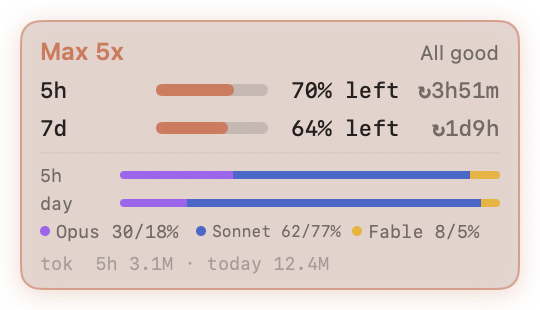

# ClaudeMeter

A tiny always-on-top macOS widget that shows how much of your Claude plan is left.

<p>
  
  &nbsp;&nbsp;
  
</p>

**At rest** it's a small circle with two rings, tinted in Claude clay:

- the outer ring is the 5-hour window
- the inner ring is the 7-day window
- the number in the center is the 5-hour % left

**Hover** over it and it morphs into the full panel. Move the pointer away and it shrinks back.

## What it shows

- **Plan**: Pro / Max 5x / Max 20x / Team / Enterprise
- **Limits**: 5-hour and 7-day windows, plus per-model weekly windows when your plan has them. Each shows % left and a reset countdown. Bars turn red at 20% or less.
- **Model mix**: share of Claude Code tokens by Opus / Sonnet / Fable / Haiku, for the current 5-hour window and for today
- **Tokens**: Claude Code tokens in the current 5-hour window and today

## Behavior

- Floats above every window, on every Space, and over full-screen apps
- Has no Dock icon and no menu bar item
- Drag it anywhere and it remembers the spot. It always expands toward the middle of the screen and collapses back to exactly where it was.
- Right-click it for **Refresh**, **Launch at Login** and **Quit**

## Requirements

- macOS 13 or later
- Xcode Command Line Tools (`xcode-select --install`)
- [Claude Code](https://claude.com/claude-code), signed in at least once. ClaudeMeter reuses its login.

## Build and run

```bash
git clone https://github.com/ychu824/ClaudeMeter.git
cd ClaudeMeter
./build.sh
open ClaudeMeter.app
```

On first launch, macOS asks whether `security` may read the `Claude Code-credentials` Keychain item. Choose **Always Allow**.

To keep it running, move `ClaudeMeter.app` to `/Applications`, then right-click the widget and choose **Launch at Login**.

To update later:

```bash
git pull && ./build.sh
```

## How it works

| What | Source | Refresh |
|---|---|---|
| Limit % and reset times | `GET api.anthropic.com/api/oauth/usage`, using Claude Code's OAuth token from the Keychain | every 90 s |
| Plan name | `subscriptionType` / `rateLimitTier` in the same Keychain entry, with `/api/oauth/profile` as a fallback | once |
| Tokens and model mix | Claude Code's session logs, `~/.claude/projects/**/*.jsonl` | every 5 s, and immediately when you hover |

Some details on each:

- **Limits are account-wide.** claude.ai, the desktop app and Claude Code all draw on the same limits, so the percentages reflect everything.
- **Tokens and model mix cover Claude Code only.** Chats on claude.ai aren't logged locally.
- **Token counting.** Tokens are counted as input + output + cache writes. Cache reads are excluded.
- **Token share is not limit share.** Opus and Fable tokens weigh more against your limits than Sonnet tokens.
- **Log reading is incremental.** ClaudeMeter remembers a byte offset per log file and parses only newly appended lines, so a scan takes milliseconds even with a large history.
- **Rate limits.** The last good usage response is cached, so a relaunch shows numbers immediately. If the endpoint returns 429, ClaudeMeter backs off per `Retry-After` (at least 2 minutes) and keeps showing the cached values.
- **Token refresh.** ClaudeMeter never refreshes the OAuth token itself, so it can't interfere with Claude Code's stored credentials. When the token expires, the widget says so. Open Claude Code once and it refreshes the token.

## Privacy

- The OAuth token is read from the Keychain and sent only to `api.anthropic.com`. It is never stored by ClaudeMeter.
- Two things are saved in the app's `UserDefaults`: the widget position and the last usage response (percentages and reset times).
- Nothing else leaves your machine.

## Caveats

- `/api/oauth/usage` and `/api/oauth/profile` are **undocumented** endpoints and may change without notice. Only the known limit keys (`five_hour`, `seven_day`, `seven_day_opus`, `seven_day_sonnet`) are displayed.
- `build.sh` ad-hoc signs the app, and it is not notarized. Build it yourself rather than passing the binary around.

## License

[MIT](LICENSE)

---

This is an unofficial community tool. It is not affiliated with or endorsed by Anthropic.
