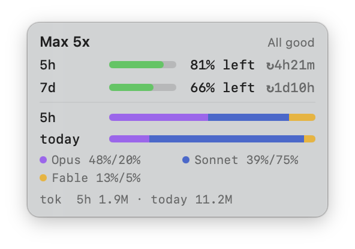

# ClaudeMeter

A tiny always-on-top macOS widget that shows how much of your Claude plan is left.



- **Plan limits**: 5-hour and 7-day windows (plus per-model weekly windows when your plan has them), shown as % left with a reset countdown
- **Plan name**: Pro / Max 5x / Max 20x / Team / Enterprise
- **Token usage**: Claude Code tokens in the current 5-hour window and today
- **Model mix**: share of tokens by Opus / Sonnet / Fable / Haiku

It floats above every window, on every Space and over full-screen apps. It has no Dock icon and no menu bar item. Drag it anywhere and it remembers its position. Right-click it for Refresh, Launch at Login and Quit.

## Requirements

- macOS 13 or later
- Xcode Command Line Tools (`xcode-select --install`)
- [Claude Code](https://claude.com/claude-code), signed in at least once. ClaudeMeter reuses its login.

## Build and run

```bash
./build.sh
open ClaudeMeter.app
```

On first launch macOS asks whether `security` may read the `Claude Code-credentials` Keychain item. Choose **Always Allow**.

To keep it running, move `ClaudeMeter.app` to `/Applications`, then right-click the widget → **Launch at Login**.

## How it works

| What | Source |
|---|---|
| Limit % and reset times | `GET https://api.anthropic.com/api/oauth/usage`, using Claude Code's OAuth token from the macOS Keychain. Polled every 90 s. |
| Plan name | `subscriptionType` / `rateLimitTier` in the same Keychain entry. Falls back to `/api/oauth/profile`. |
| Token counts and model mix | Claude Code's local session logs in `~/.claude/projects/**/*.jsonl` |

The limit percentages are account-wide: claude.ai, the desktop app and Claude Code share the same limits.

Token counts and the model mix cover **Claude Code only**, because chats on claude.ai aren't logged locally. Tokens are counted as input + output + cache writes, and cache reads are excluded.

Token share is not the same as limit share. Opus and Fable tokens count more heavily against your limits than Sonnet tokens.

ClaudeMeter never refreshes the OAuth token itself, so it can't interfere with Claude Code's stored credentials. When the token expires, the widget says so. Open Claude Code once and it refreshes the token.

## Privacy

The token is read locally and sent only to `api.anthropic.com`. Nothing else leaves your machine, and nothing is written to disk.

## Caveats

- `/api/oauth/usage` and `/api/oauth/profile` are **undocumented** endpoints and may change without notice. Only the known limit keys (`five_hour`, `seven_day`, `seven_day_opus`, `seven_day_sonnet`) are displayed.
- The app is ad-hoc signed by `build.sh`, not notarized. Build it yourself rather than distributing the binary.

## License

[MIT](LICENSE)

---

This is an unofficial community tool. It is not affiliated with or endorsed by Anthropic.
